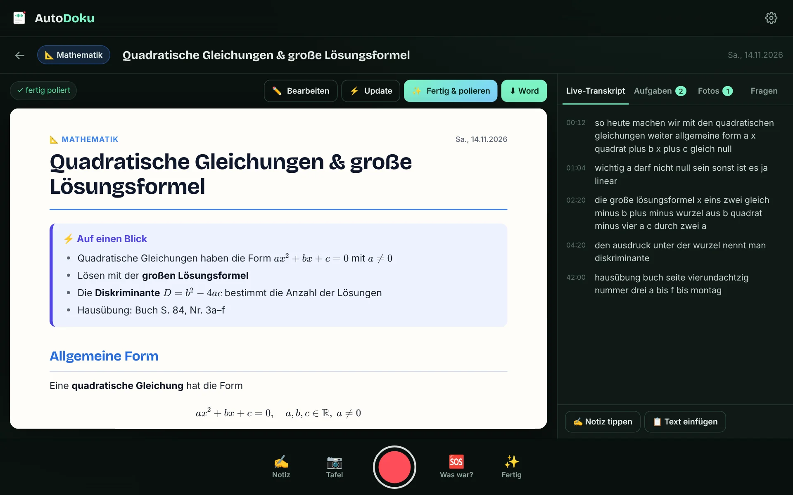
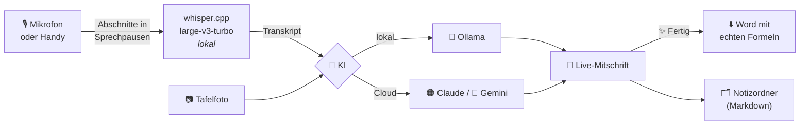
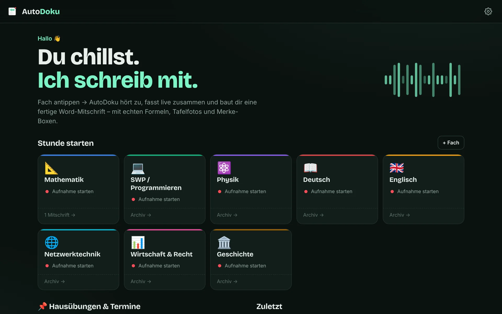
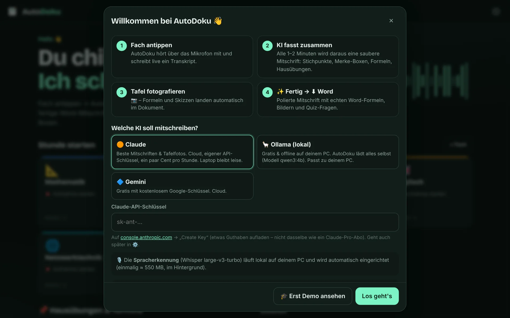
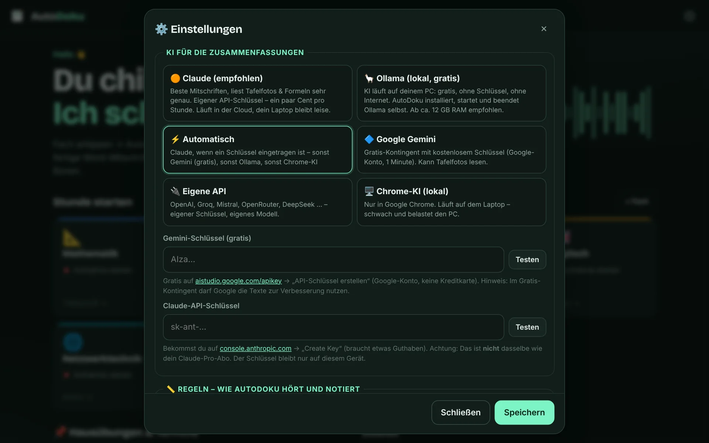

<div align="center">

<picture>
  <source media="(prefers-color-scheme: dark)" srcset="docs/readme/banner-dark.svg">
  
</picture>

**AutoDoku hört im Unterricht mit und schreibt daraus live eine saubere Mitschrift –<br>mit echten Word-Formeln, Tafelfotos, Hausübungen und Quiz zum Lernen.**

[](https://github.com/FreeOnur/autodoku/releases/latest)
[](https://github.com/FreeOnur/autodoku/releases)
[](#-installieren)
[](https://www.electronjs.org/)
[](LICENSE.md)

<a href="https://github.com/FreeOnur/autodoku/releases/latest/download/AutoDoku-Setup.exe"></a>
&nbsp;
<a href="https://freeonur.github.io/autodoku/"></a>

<br><br>



</div>

---

<details>
<summary><b>📑 Inhalt</b></summary>

- [✨ Was AutoDoku kann](#-was-autodoku-kann)
- [⬇️ Installieren](#️-installieren)
- [🧠 Welche KI?](#-welche-ki)
- [⚙️ So funktioniert's](#️-so-funktionierts)
- [🖼️ Screenshots](#️-screenshots)
- [📚 Alle Funktionen im Detail](#-alle-funktionen-im-detail)
- [🔒 Datenschutz & Fairness](#-datenschutz--fairness)
- [🛠️ Für Entwickler](#️-für-entwickler)
- [❓ FAQ](#-faq)

</details>

## ✨ Was AutoDoku kann

| | |
|---|---|
| 🎙️ **Live-Transkript** | Fach antippen – AutoDoku hört zu, der Text erscheint nach jeder Sprechpause. |
| ⚡ **Live-Mitschrift** | Alle 1–2 Minuten wird daraus eine saubere Mitschrift: Stichpunkte, Merke-, Definitions- und Formel-Boxen. |
| 🧮 **Mathe richtig** | „x hoch zwei durch zwei a“ wird zu $\frac{x^2}{2a}$ – in Word als **echte, bearbeitbare Formel**. |
| 📷 **Tafelfotos** | Tafel, Folie oder Heft fotografieren – die KI überträgt Text und Formeln, das Foto kommt mit ins Dokument. |
| 📌 **Hausübungen & Termine** | werden automatisch erkannt und auf der Startseite gesammelt. |
| 🆘 **„Was war gerade?“** | Kurz weggeträumt? Ein Tipp – Zusammenfassung der letzten 3 Minuten plus Antwortvorschlag. |
| ✨ **Fertig & polieren** | „Auf einen Blick“-Box, logisch sortiert, Begriffe-Tabelle, „Teste dich selbst“ mit Lösungen. |
| ⬇️ **Word-Export** | Farbige Boxen, Tabellen, Bilder, Kopf-/Fußzeile, Seitenzahlen. |
| 🗂️ **Notizordner** | Wie Obsidian: jede Stunde als Markdown-Notiz, PDFs, Videos und Word-Dateien werden automatisch zu Notizen. |
| 📱 **Handy als Tafel-Kamera** | QR-Code scannen – das Handy fotografiert die Tafel und nimmt auf, ganz ohne App. |

> [!TIP]
> **Alles läuft auf deinem PC, wenn du willst.** Die Spracherkennung (Whisper large-v3-turbo) ist immer lokal. Für die Mitschrift wählst du **Ollama** (lokal, gratis) oder **Claude** (Cloud, beste Qualität).

## ⬇️ Installieren

### Windows 10 / 11

1. **[AutoDoku-Setup.exe herunterladen](https://github.com/FreeOnur/autodoku/releases/latest/download/AutoDoku-Setup.exe)** (ca. 130 MB) und öffnen.
2. Beim ersten Start wählst du deine KI. Den Rest erledigt der **Einrichtungs-Assistent** im Hintergrund:

   | Was | Größe | Wann |
   |---|---|---|
   | 🎙️ Spracherkennung (whisper.cpp + Whisper large-v3-turbo) | ≈ 550 MB | immer, einmalig |
   | 🦙 Ollama (nur CPU/Vulkan-Teil, ohne Autostart) | ≈ 40 MB | wenn du Ollama wählst |
   | 🧠 KI-Modell, passend zu deinem RAM (`qwen3:4b` ab 12 GB) | 1,4–2,6 GB | wenn du Ollama wählst |

3. Fertig. **Updates** meldet AutoDoku selbst (⚙️ → *Über AutoDoku* → *Jetzt aktualisieren*). Notizen, Einstellungen und Downloads bleiben erhalten.

> [!NOTE]
> Windows zeigt eventuell „Der Computer wurde durch Windows geschützt“, weil die App (noch) kein kostenpflichtiges Zertifikat hat: **Weitere Informationen → Trotzdem ausführen**.

### Mac, Linux, Chromebook

Die **[Browser-Version](https://freeonur.github.io/autodoku/)** in Chrome öffnen. Für die Spracherkennung dort am besten einen gratis [Groq-Schlüssel](https://console.groq.com/keys) eintragen.

## 🧠 Welche KI?

| | 🟠 **Claude** | 🦙 **Ollama** | 🔷 **Gemini** |
|---|---|---|---|
| Läuft | in der Cloud | **auf deinem PC** | in der Cloud |
| Kosten | ca. 5–12 Cent pro Stunde | **gratis** | gratis (Kontingent) |
| Qualität der Mitschrift | ⭐⭐⭐⭐⭐ | ⭐⭐⭐ | ⭐⭐⭐⭐ |
| Tafelfotos & Formeln | sehr genau | mit `gemma3:4b` | gut |
| Internet nötig | ja | **nein** | ja |
| Belastet den Laptop | nein | mittel (Kerne einstellbar) | nein |
| Brauchst du | [API-Schlüssel](https://console.anthropic.com/settings/keys) | ab ca. 12 GB RAM | [Gratis-Schlüssel](https://aistudio.google.com/apikey) |

Außerdem: **🔌 Eigene API** (OpenAI, Groq, Mistral, OpenRouter, DeepSeek, LM Studio) und die **Chrome-KI** in der Browser-Version.

<details>
<summary><b>💰 Kosten mit Claude im Detail</b></summary>

| Sparstufe | Was passiert | ca. pro 50-min-Stunde |
|---|---|---|
| ✨ **Beste Qualität** (Standard) | live Haiku 5.5, „Fertig“ & Tafelfotos mit Sonnet 5.5 | 5–12 Cent |
| 💸 **Sparmodus** | alles mit Haiku 5.5, Live-Update alle 90 s | 1–3 Cent |
| 🪙 **Nur am Ende** | während der Stunde nur Transkript, am Ende eine Zusammenfassung | unter 1 Cent |

AutoDoku zeigt bei jeder Stunde 💰 an, was sie gekostet hat. Der API-Schlüssel ist **nicht** dasselbe wie ein Claude-Pro-Abo – er wird extra nach Verbrauch abgerechnet. Aktuelle Preise: [Claude-Preisseite](https://platform.claude.com/docs/en/about-claude/pricing).

</details>

## ⚙️ So funktioniert's



**Damit dein Laptop leise bleibt:**

- **Nichts läuft auf Vorrat.** whisper.cpp und Ollama starten erst, wenn sie gebraucht werden, mit niedriger Priorität und begrenzten Kernen (⚙️ → *Leistung*: Leise / Ausgewogen / Schnell).
- **Nach 10 Minuten Pause** werden Whisper- und KI-Modell aus dem Arbeitsspeicher entladen.
- **Beim Schließen von AutoDoku** wird alles beendet – auch Ollama (abschaltbar).
- Ollama wird **ohne Windows-Autostart** eingerichtet, und AutoDoku lädt nur den Teil, den dein PC braucht (≈ 40 MB statt 1,6 GB; den NVIDIA-Teil nur mit NVIDIA-Grafikkarte).

## 🖼️ Screenshots

<table>
  <tr>
    <td width="50%"><br><sub><b>Startseite</b> – Fach antippen, Aufnahme läuft.</sub></td>
    <td width="50%"><br><sub><b>Erster Start</b> – KI wählen, der Rest richtet sich selbst ein.</sub></td>
  </tr>
  <tr>
    <td width="50%"><br><sub><b>Mitschrift</b> – Formeln, Merke-Boxen, Live-Transkript.</sub></td>
    <td width="50%"><br><sub><b>Einstellungen</b> – Claude, Ollama, Gemini oder eigene API.</sub></td>
  </tr>
</table>

## 📚 Alle Funktionen im Detail

<details>
<summary><b>🗂️ Notizordner – wie Obsidian, direkt in AutoDoku</b></summary>

Links der **Ordnerbaum**, rechts öffnen sich Dateien in **Tabs** (Strg+O Schnellsuche, Strg+N neue Notiz, Strg+E Bearbeiten/Lesen, Strg+S speichern).

- **Ordner wählen:** ⚙️ → *Notizordner*. Ein bestehender Obsidian-Vault geht auch – AutoDoku schreibt normale `.md`-Dateien.
- **Jede Stunde wird automatisch zur Notiz:** `Mathematik/2026-10-20 Quadratische Gleichungen.md` mit Eigenschaften, Tafelfotos in `Anhänge/`, Hausübungen als `- [ ]`-Aufgaben, Transkript in `Transkripte/`, Word-Export in `Word/`.
- **Markdown:** `[[Wikilinks]]`, `![[Einbettungen]]`, `#tags`, Callouts, Formeln, Code mit Farben, Bilder per Strg+V.
- **PDFs** ansehen und **Formulare ausfüllen**, **Bilder, Videos, Audio, Code, Word** öffnen.
- **Automatisch umwandeln:** PDFs, Fotos, Videos/Audio oder Word-Dateien in den Ordner legen – AutoDoku macht daraus `<Name> – Notizen.md` (PDF-Text bzw. Texterkennung, lokale Spracherkennung für Videos).
- **Mathcad Prime:** Jede Formel hat **📋 Mathcad** – kopiert sie in Mathcad-Schreibweise.

</details>

<details>
<summary><b>🎧 Fachbegriffe, Sprache & Mikrofon</b></summary>

- Die Spracherkennung nimmt die **Sprache des Fachs** (Englisch-Stunden auf Englisch).
- Whisper bekommt bei jedem Abschnitt **Fach, Fachbegriffe und den letzten Satz** als Hinweis – so werden Begriffe wie *ArrayList* oder *Subnetzmaske* richtig geschrieben. Die KI korrigiert zusätzlich falsch Verstandenes.
- Pro Fach gibt's eine Liste **Fachbegriffe** (⚙️ → Fächer), dazu eine für alle Fächer.
- ⚙️ → *Mikrofon*: Headset oder USB-Mikrofon wählen. Ein grüner Balken zeigt, ob etwas ankommt.

</details>

<details>
<summary><b>🛟 Damit nichts verloren geht</b></summary>

- **Leise Lehrer:** Die Erkennung misst das Grundrauschen und passt sich an.
- **Keine zerschnittenen Wörter:** Geschnitten wird in Sprechpausen, sonst an der leisesten Stelle.
- **Rückstau:** Kommt die Erkennung nicht nach, warten die Abschnitte – nichts wird verworfen.
- **Ende der Stunde:** „✨ Fertig“ wartet, bis die letzten Sekunden erkannt sind (oft kommt genau da die Hausübung).
- **Lokale KI:** Neuer Text wird in passenden Portionen verarbeitet statt abgeschnitten.
- **WLAN-Aussetzer:** Anfragen werden automatisch wiederholt.

</details>

<details>
<summary><b>📏 Regeln – wie AutoDoku hört und notiert</b></summary>

⚙️ → *Regeln*:
- **So soll notiert werden** – z. B. „jede Definition als eigene Box“.
- **Beim Hören beachten** – z. B. „Prof. Huber sagt ‚Strich‘ für Ableitung“.
- **Witze, Abschweifungen & Ermahnungen** lässt AutoDoku weg. Hilft ein Witz beim Merken, bleibt die Eselsbrücke.
- **Fachbegriffe als eigene Notizen** in `Begriffe/`, verlinkt als `[[Begriff]]`.

</details>

<details>
<summary><b>🖥️ Mini-Fenster & Tastenkürzel</b></summary>

| Kürzel | macht |
|---|---|
| <kbd>Strg</kbd> + <kbd>Alt</kbd> + <kbd>A</kbd> | AutoDoku ein-/ausblenden (Aufnahme läuft weiter) |
| <kbd>Strg</kbd> + <kbd>Alt</kbd> + <kbd>R</kbd> | Aufnahme starten / pausieren |
| <kbd>Strg</kbd> + <kbd>Alt</kbd> + <kbd>N</kbd> | Schnellnotiz in die laufende Stunde |
| <kbd>Strg</kbd> + <kbd>Alt</kbd> + <kbd>K</kbd> | Mini-Fenster ein/aus |

Solange aufgenommen wird, ist immer ein **roter Punkt** sichtbar – eine Aufnahme soll nie unbemerkt laufen.

</details>

<details>
<summary><b>📱 Handy als Tafel-Kamera & Mikrofon</b></summary>

1. Am Laptop **📱** → QR-Code mit dem Handy scannen.
2. Im Handy-Browser „Verbindung nicht privat“ → *Erweitert* → *Weiter* (eigenes Zertifikat, trotzdem verschlüsselt).
3. Windows fragt nach dem Netzwerkzugriff → **Zulassen**.

- **📷 Tafel:** Foto per Klick oder automatisch, sobald sich die Tafel ändert und niemand davorsteht.
- **🎙️ Aufnahme:** Ist der Laptop nicht erreichbar, bleibt alles am Handy gespeichert und wird nachgeschickt.
- Schul-WLAN blockiert Geräte untereinander? Handy-**Hotspot** einschalten und den Laptop damit verbinden.

</details>

<details>
<summary><b>🤝 Für Kollegen: Profil teilen</b></summary>

⚙️ → *Profil teilen* → **Profil exportieren**: Fächer, Fachbegriffe, Regeln und KI-Einstellungen in einer Datei, ohne deine Schlüssel. Kollegen importieren sie und tragen nur ihre eigenen Schlüssel ein.

</details>

## 🔒 Datenschutz & Fairness

- **Kein Audio wird gespeichert**, nur Text. Mitschriften, Fotos und Schlüssel bleiben auf deinem Gerät.
- Die Spracherkennung läuft lokal – Audio verlässt deinen PC nicht. Nur wer Claude, Gemini oder Groq wählt, schickt Text bzw. Audio-Abschnitte an diesen Dienst.
- **Frag deine Lehrkraft kurz, ob Mitschreiben per App okay ist.** Das ist fair und gehört zur Hausordnung.

## 🛠️ Für Entwickler

```bash
npm install      # Electron + electron-builder
npm start        # Desktop-App starten
npm run web      # Browser-Version auf http://localhost:5317
```

**Neue Version veröffentlichen:** Version in `package.json` erhöhen, committen und einen Tag pushen:

```bash
git tag v3.3.1 && git push origin main --tags
```

GitHub Actions ([`release.yml`](.github/workflows/release.yml)) baut dann auf Windows `AutoDoku-Setup.exe` und hängt sie an ein neues Release – mit den Notizen aus [`build/release-notes.md`](build/release-notes.md) (vorher anpassen). Die Release-Aktion lässt sich auch ohne Tag unter *Actions → Release → Run workflow* starten. Die installierten Apps finden das Update von selbst.

<details>
<summary><b>📁 Projektstruktur</b></summary>

```
index.html, mini.html      App-Oberfläche und Mini-Fenster
css/app.css                Design (dunkle „Tafel“ + helles „Papier“)
js/app.js                  Oberfläche, Aufnahme-Ablauf, Einstellungen, Export
js/ai.js                   KI-Weiche: Claude, Ollama, Gemini, eigene API, Chrome-KI
js/whisper.js              Spracherkennung: lokal (whisper.cpp), Groq, Gemini, Browser
js/setup.js                Einrichtungs-Assistent und Updates
js/prompts.js              alle Anweisungen an die KI
js/latex2omml.js           LaTeX → Word-Formeln (OMML), selbst geschrieben
js/docx.js                 baut die .docx-Datei direkt
js/vault.js, convert.js    Notizordner und automatische Umwandlung
desktop/main.js            Electron: lokaler Server, Fenster, Tray, Kürzel, Handy
desktop/localstt.js        whisper.cpp starten/stoppen, Modell laden
desktop/ollama.js          Ollama installieren/starten/beenden
desktop/remotezip.js       lädt nur benötigte Dateien aus großen ZIPs (HTTP-Range)
desktop/updater.js         Updates über GitHub Releases
build/installer.nsh        Zusätze für den Windows-Installer
vendor/                    KaTeX, JSZip, PDF.js, Tesseract, … (eigene Lizenzen)
```

</details>

## ❓ FAQ

<details>
<summary><b>Mein Laptop wird laut / langsam.</b></summary>

⚙️ → Live-Mitschrift → *Leistung* auf **Leise** stellen. Mit Ollama hilft außerdem ein kleineres Modell (`qwen3:1.7b`) – oder du nimmst Claude, dann läuft die Mitschrift in der Cloud.
</details>

<details>
<summary><b>Ich hatte Ollama schon installiert.</b></summary>

AutoDoku nutzt deine Installation und deine Modelle. Beim Schließen wird Ollama beendet (⚙️ → KI → abschaltbar). Mit **„Ollama-Autostart von Windows ausschalten“** startet es nicht mehr bei jedem Hochfahren – AutoDoku startet es bei Bedarf selbst.
</details>

<details>
<summary><b>Wo liegen meine Daten?</b></summary>

Einstellungen und Downloads (Whisper-Modell, Ollama) in `%APPDATA%\AutoDoku`, Notizen in deinem Notizordner, Word-Dateien in `Dokumente\AutoDoku` bzw. im Notizordner unter `Word/`. Beim Deinstallieren bleibt alles erhalten.
</details>

<details>
<summary><b>Geht das auch ohne Internet?</b></summary>

Ja, mit Ollama komplett: Spracherkennung und Mitschrift laufen lokal. Internet brauchst du nur einmal zum Einrichten.
</details>

---

<div align="center">
<sub>Gemacht von <a href="https://github.com/FreeOnur">FreeOnur</a> · <a href="LICENSE.md">Lizenz</a> (Code einsehbar, kein Open Source) · whisper.cpp und Ollama gehören ihren Autoren</sub>
</div>
